<div align="center">



<p>
  <a href="https://psygiox-dev.vercel.app/"></a>
  <a href="https://t.me/PsyGioX"></a>
  <a href="https://t.me/spprotech"></a>
  <a href="https://t.me/PsyGioX_TechVerse"></a>
  
</p>

</div>


## ☕ About

```ts
const PsyGioX = {
  roles:   ["Fullstack Web Developer", "UI/UX Designer", "Digital Creator", "SMM Manager"],
  studio:  "SP Developer",
  desk:    "Debian Forky + Wayland",
  builds:  ["offline-first PWAs", "Vercel-hosted tools", "PHP engines with admin panels", "streamer tools"],
  vibe:    ["lo-fi", "pastel UI", "glassmorphism", "anime", "open source", "creative coding"],
  playing: "lofi beats to code to",
};
```


## 🎧 Projects

<table>
  <tr>
    <td width="50%" valign="top">
      <h3>🗒️ Local Notes</h3>
      <p>Fully local, encrypted PWA for notes. Custom rich-text editor, IndexedDB storage, wiki-links between notes, command palette, per-note version history, templates with variables, and import from Notion, Evernote and Google Keep. 12 languages, plus a Capacitor wrapper for mobile.</p>
      <p>
        
        
        
        
      </p>
      <a href="https://github.com/PsyGioX/localnotes"></a>
    </td>
    <td width="50%" valign="top">
      <h3>🦊 KitsuneWatch</h3>
      <p>Free anime streaming site as a vanilla JS single-page app with no framework. Vercel serverless functions proxy the Kodik API, so the token never reaches the browser. Search, top lists, release years and a calendar.</p>
      <p>
        
        
        
      </p>
      <a href="https://kitsunewatch.vercel.app"></a>
      <a href="https://github.com/PsyGioX/kitsunewatch"></a>
    </td>
  </tr>
  <tr>
    <td width="50%" valign="top">
      <h3>🎰 Random Challenge Hub</h3>
      <p>Roulette of gaming challenges for streamers. Five roulette modes, a donation auction (Streamlabs, DonationAlerts, Twitch), an OBS Browser Source overlay, Twitch chat voting and a viewer wheel. Five themes, ten palettes, en/ru/uk. No build step, no dependencies, and all data stays in the browser.</p>
      <p>
        
        
        
      </p>
      <a href="https://random-challenge-hub.vercel.app"></a>
      <a href="https://github.com/PsyGioX/Random-Challenge-Hub"></a>
    </td>
    <td width="50%" valign="top">
      <h3>📰 Fluent RSS Reader 2.0</h3>
      <p>Pastel RSS aggregator as an installable PWA. Build-less frontend with a Vercel serverless API on Node 20 ESM. Seven interface languages: ru, en, uk, pl, cs, bg, sr.</p>
      <p>
        
        
        
      </p>
      <a href="https://fluent-rss-reader-web.vercel.app"></a>
    </td>
  </tr>
  <tr>
    <td width="50%" valign="top">
      <h3>🎮 Streamer Card</h3>
      <p>Business-card website for streamers on PHP and MySQL. Admin panel with bulk actions and modals, Twitch-style info panels on the home page, and the SEO files needed for fast indexing.</p>
      <p>
        
        
        
      </p>
      <a href="https://github.com/PsyGioX/streamercardwebsite"></a>
    </td>
    <td width="50%" valign="top">
      <h3>🏙️ CityPortal</h3>
      <p>PHP engine for a city news portal. News with numbered pagination and a "load more" button, plus an admin panel for managing content.</p>
      <p>
        
        
      </p>
      <a href="https://github.com/PsyGioX/cityportalru"></a>
    </td>
  </tr>
  <tr>
    <td colspan="2" valign="top">
      <h3>🌐 PsyGioX Website</h3>
      <p>My portfolio and TechVerse blog. Posts and projects are plain Markdown files, with a set of free web tools alongside, including an OGG viewer and a meta-tags and link-preview checker.</p>
      <p>
        
        
        
      </p>
      <a href="https://psygiox-dev.vercel.app/"></a>
    </td>
  </tr>
</table>


## 📻 Channels

<table>
  <tr>
    <td width="100%" valign="top">
      <h3>🪐 PsyGioX TechVerse</h3>
      <p>The channel that goes with the blog on my site, covering all kinds of topics and not only web development.</p>
      <a href="https://t.me/PsyGioX_TechVerse"></a>
    </td>
  </tr>
</table>


## 🧺 Stack

<p align="center">
  
  <br/>
  
  <br/>
  
  <br/>
  
</p>


## 🌙 Activity

<p align="center">
  
  
</p>

<p align="center">
  
</p>

<p align="center">
  <picture>
    <source media="(prefers-color-scheme: light)" srcset="https://raw.githubusercontent.com/PsyGioX/PsyGioX/output/snake-light.svg"/>
    
  </picture>
</p>


